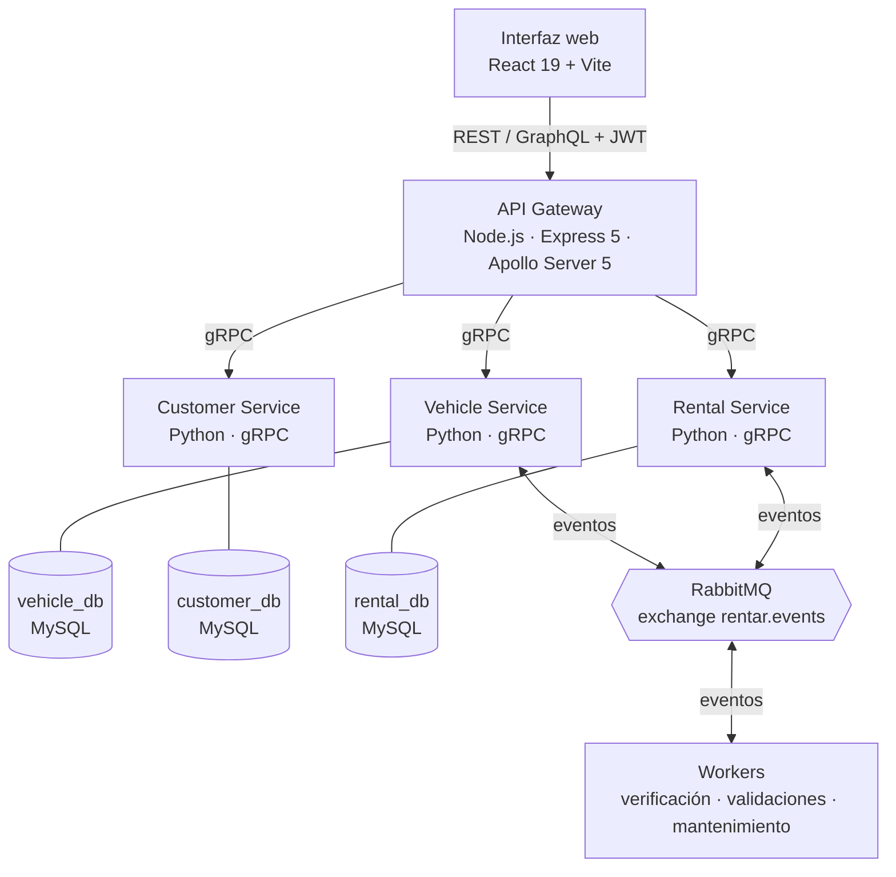

# Rentar: sistema distribuido de alquiler de vehículos

Trabajo práctico de **Desarrollo de Software en Sistemas Distribuidos**, Universidad Nacional de Lanús (UNLa).

Rentar administra la flota de vehículos, los clientes y las reservas de una empresa de alquiler. El sistema se construyó de forma incremental en tres hitos. En cada uno se incorporó un mecanismo de comunicación distinto entre componentes, manteniendo las funcionalidades y la interfaz web de los anteriores.

| Hito | Mecanismo | Qué incorporó |
| --- | --- | --- |
| **1** | REST / GraphQL | Interfaz web y API con las 7 funcionalidades del negocio. REST documentado con Swagger y GraphQL con tipos y operaciones documentados. |
| **2** | RPC (gRPC) | Separación en tres servicios independientes (vehículos, clientes, reservas), cada uno con su base de datos, detrás de un API Gateway. Contratos `.proto` documentados. Gateway en Node.js y servicios en Python. |
| **3** | RabbitMQ | Comunicación asíncrona basada en eventos para procesos que no deben bloquear el flujo principal: verificación de patentes, incorporación de vehículos de propietarios externos y mantenimiento preventivo. |

## Arquitectura



- **La interfaz web solo habla con el API Gateway.** El Gateway valida el JWT y los permisos por rol, decide qué servicios intervienen y arma la respuesta. Nunca accede a las bases de datos de los servicios.
- **Cada servicio es dueño de su dominio y de su base de datos.** Las reglas de negocio viven en el servicio responsable. Rental Service guarda los IDs de cliente y vehículo sin claves foráneas entre servicios.
- **Las operaciones que necesitan varios servicios las coordina el Gateway.** Por ejemplo, para crear una reserva verifica en paralelo que el cliente exista y esté activo (Customer), que el vehículo esté activo y operativo (Vehicle) y que el período esté libre (Rental). Recién entonces pide a Rental Service que la cree; Rental vuelve a controlar el solapamiento con un bloqueo por vehículo para cubrir solicitudes concurrentes.
- **Lo síncrono va por gRPC y lo asíncrono por eventos.** Usamos gRPC cuando el usuario necesita la respuesta para continuar (consultar, validar, reservar). Usamos eventos cuando el proceso puede completarse después sin bloquear al usuario (verificar una patente, validar un vehículo externo, programar un mantenimiento).

| Componente | Tecnología | Puerto local |
| --- | --- | --- |
| Interfaz web | React 19, React Router 7, Vite 8 | `5173` |
| API Gateway | Node.js 22, Express 5, Apollo Server 5, `@grpc/grpc-js` | `5000` |
| Vehicle Service | Python 3.10, gRPC, SQLAlchemy, Alembic | `50051` |
| Customer Service | Python 3.10, gRPC, SQLAlchemy, bcrypt | `50052` |
| Rental Service | Python 3.10, gRPC, SQLAlchemy | `50053` |
| Bases de datos | MySQL 8 (una por servicio) | `3308` / `3307` / `3309` |
| Broker | RabbitMQ 3.13 (AMQP + panel de administración) | `5672` / `15672` |

## Funcionalidades

| # | Funcionalidad | Rol | Interfaz | Operación en el Gateway | Servicios |
| --- | --- | --- | --- | --- | --- |
| 1 | Gestión de vehículos (alta, modificación, baja lógica, consulta) | Administrador | REST | `GET/POST /api/vehiculos`, `GET/PUT/DELETE /api/vehiculos/{id}` | Vehicle |
| 2 | Consulta de disponibilidad por período y filtros | Cliente | GraphQL | `vehiculosDisponibles` | Vehicle + Rental |
| 3 | Gestión de clientes (alta, modificación, baja lógica, consulta) | Administrador | REST | `GET/POST /api/clientes`, `GET/PUT/DELETE /api/clientes/{id}` | Customer |
| 4 | Alta de reserva | Cliente | REST | `POST /api/reservas` | Customer + Vehicle + Rental |
| 5 | Consulta de reservas | Cliente / Administrador | GraphQL | `reservasPorCliente` | Rental + Customer + Vehicle |
| 6 | Cancelación de reserva | Cliente | REST | `PATCH /api/reservas/{id}/cancelar` | Rental |
| 7 | Historial de alquileres | Cliente | GraphQL | `historialReservas` | Rental + Vehicle |

Reglas de negocio principales:

- Todo vehículo nuevo queda `DISPONIBLE`. La patente es única y no se puede modificar.
- Vehículos y clientes se dan de baja de forma lógica: los inactivos no pueden participar de nuevos alquileres.
- Una reserva exige un cliente y un vehículo activos, una fecha de inicio futura, una fecha de fin posterior al inicio y un período sin otra reserva confirmada.
- El importe total es la cantidad de días de alquiler (redondeada hacia arriba) por el precio diario. La reserva se crea `CONFIRMADA`.
- Solo se puede cancelar una reserva que todavía no comenzó. Queda `CANCELADA` sin borrarse y libera el período.

### Eventos asíncronos (Hito 3)

Todos los eventos circulan por el exchange `rentar.events` (tipo `topic`). Cada consumidor tiene su propia cola durable. Un mensaje que falla al procesarse va a la dead-letter queue `rentar.dlq`. El servicio `broker-init` declara toda la topología al levantar el stack, para que ningún evento se pierda si un consumidor todavía no arrancó.

| Proceso | Eventos | Estado |
| --- | --- | --- |
| **Verificación de vehículos:** al registrar un vehículo se verifica su patente contra un registro policial simulado. Si figura como robado, queda inhabilitado para nuevas operaciones (sin agregar un estado nuevo). | `vehiculos.verificacion.solicitada` → `vehiculos.verificacion.resultado` | En desarrollo (`feature/verificacion-vehiculos`) |
| **Incorporación de vehículos externos:** un cliente registra un vehículo propio, que queda `PENDIENTE`. Dos validadores independientes (patente y titularidad) informan su resultado y un correlador los combina. Si ambos validan, el vehículo pasa a `DISPONIBLE`. | `vehiculos.externos.registrados` → `...validacion.patente` + `...validacion.titularidad` → `...validacion.completada` | En desarrollo (`feature/vehiculos-externos`) |
| **Mantenimiento preventivo:** al confirmarse una reserva se genera una solicitud de mantenimiento y su resultado se registra asociado a la reserva. La confirmación no espera al mantenimiento. | `reserva.confirmada` → `mantenimiento.resultado` | Pendiente |

La infraestructura del broker, la topología, los contratos de todos los eventos y los helpers de publicación y consumo ya están en `main`. La estructura de cada evento está documentada en [docs/eventos/README.md](docs/eventos/README.md) y validada con [docs/eventos/contratos.schema.json](docs/eventos/contratos.schema.json).

## Inicio rápido

Requisitos: Docker Engine y Docker Compose.

```bash
git clone https://github.com/alejoalmiron/rentar-backend.git
cd rentar-backend
docker compose --env-file .env.example up --build -d
```

`.env.example` trae valores de desarrollo listos para usar. Para personalizarlos, copialo como `.env` (está ignorado por Git), editalo y levantá con `docker compose up --build -d`. Las credenciales de ejemplo son solo para uso local; fuera de desarrollo configurá un `JWT_SECRET` aleatorio de al menos 32 caracteres.

| Acceso | URL |
| --- | --- |
| Interfaz web | http://localhost:5173 |
| API REST | http://localhost:5000/api |
| Swagger (documentación REST) | http://localhost:5000/api-docs |
| GraphQL (sandbox) | http://localhost:5000/graphql |
| Panel de RabbitMQ | http://localhost:15672 (usuario `RABBITMQ_USER` / `RABBITMQ_PASS`) |

Para detener el sistema: `docker compose down`. Los datos persisten en volúmenes de Docker; `docker compose down -v` los borra.

### Usuarios de desarrollo

Customer Service crea estas cuentas en el primer arranque. Las contraseñas se guardan con bcrypt.

| Rol | Usuario | Contraseña |
| --- | --- | --- |
| Administrador | `admin` | `AdminRentar2026!` |
| Cliente | `cliente` | `ClienteRentar2026!` |

Se configuran con `SEED_ADMIN_USERNAME`, `SEED_ADMIN_PASSWORD`, `SEED_CLIENT_USERNAME`, `SEED_CLIENT_PASSWORD` y `SEED_CLIENT_DNI`. El seed no reemplaza contraseñas de cuentas que ya existen.

## Autenticación y permisos

`POST /api/auth/login` devuelve un JWT que la interfaz envía como `Authorization: Bearer <token>`. `POST /api/auth/logout` lo revoca en el Gateway. Los permisos se controlan en el backend, no solo en la interfaz:

- **`ADMIN`:** gestiona vehículos y clientes, consulta las reservas de cualquier cliente y el historial completo, y puede cancelar cualquier reserva.
- **`CLIENTE`:** consulta disponibilidad, crea reservas a su nombre, y consulta y cancela solo las propias. Su identidad sale del token, no de datos enviados en la solicitud.
- Sin token válido, REST responde `401`; con un rol sin permiso, `403`. GraphQL informa los mismos códigos en `errors[].extensions`.

## Contratos gRPC

Los contratos están en `services/<servicio>/proto/<dominio>/v1/*.proto`. El Gateway los carga en tiempo de ejecución y cada servicio genera sus stubs Python al construir su imagen. Tienen comentarios en cada servicio, método, mensaje, campo y valor de enum, y cumplen las reglas `STANDARD` y `COMMENTS` de Buf Lint ([buf.yaml](buf.yaml)):

```bash
npx @bufbuild/buf lint
```

- **Mensajes exclusivos:** cada RPC tiene su propio `<Metodo>Request` y `<Metodo>Response` (regla `RPC_REQUEST_RESPONSE_UNIQUE`). Las entidades (`Vehiculo`, `Cliente`, `Renta`) van dentro de la respuesta.
- **Nomenclatura:** los servicios mantienen el nombre del enunciado (`VehicleService`, `CustomerService`, `RentalService`). Métodos, mensajes, campos y enums usan el vocabulario del dominio en español, con campos en `lower_snake_case`.
- **Fechas:** `google.protobuf.Timestamp` (instante UTC). Rental Service las guarda como ISO-8601 UTC con milisegundos, así la comparación de solapamiento respeta el orden cronológico.
- **Enums:** `TipoVehiculo`, `EstadoVehiculo`, `EstadoRenta` y `Rol`. El valor `0` es `*_UNSPECIFIED` y los servicios lo rechazan con `INVALID_ARGUMENT`. El Gateway traduce entre `TIPO_VEHICULO_SEDAN` y el valor de dominio `SEDAN` ([src/grpc/enums.js](src/grpc/enums.js)).
- **Reglas en el contrato:** `CrearVehiculoRequest` no tiene `estado` (todo vehículo nuevo queda `DISPONIBLE`) y `ActualizarVehiculoRequest` no tiene `patente` (no es modificable).

## Pruebas

Sin levantar el stack:

```bash
npm test                              # sintaxis del Gateway + pruebas unitarias de JWT
npx @bufbuild/buf lint                # contratos gRPC
npm --prefix front/mi-app run lint
npm --prefix front/mi-app run build
```

Con el stack levantado. Las pruebas de Customer y Rental son de integración contra el servidor gRPC y su base:

```bash
docker compose exec vehicle-service python -m unittest discover -s /app/tests
docker compose exec customer-service python -m pytest /app/tests/test_customer_service.py
docker compose exec rental-service python -m pytest /app/tests/test_rental.py
```

Broker de eventos:

```bash
docker compose run --rm --entrypoint python broker-init smoke_test.py
docker compose exec vehicle-service python -m app.smoke_broker
```

En el panel de RabbitMQ tienen que verse el exchange `rentar.events`, el DLX `rentar.dlx`, la cola `rentar.dlq` y las colas de cada consumidor.

## Estructura del repositorio

```text
front/mi-app/                 Interfaz web React + Vite
src/                          API Gateway
  routes/ controllers/          Endpoints REST
  graphql/                      Schema y resolvers GraphQL
  grpc/                         Clientes gRPC de los tres servicios
  orchestrators/                Coordinación de operaciones entre servicios (alta de reserva)
  auth/                         JWT y control de roles
  messaging/                    Helper de RabbitMQ para Node.js
services/
  vehicle-service/              Vehículos: gRPC + vehicle_db + migraciones Alembic + eventos
  customer-service/             Clientes y cuentas: gRPC + customer_db + autenticación
  rental-service/               Reservas: gRPC + rental_db + eventos
workers/common/               Topología del broker, helper de mensajería y declaración de colas
docs/
  GRAPHQL.md                    Tipos, operaciones, permisos y errores de GraphQL
  eventos/                      Contratos de los eventos del Hito 3
buf.yaml                      Configuración de Buf Lint para los contratos gRPC
docker-compose.yml            Stack completo: bases, broker, servicios, Gateway e interfaz
prisma/schema.prisma          Modelo de datos del Hito 1 (referencia histórica, sin uso actual)
```

## Documentación

- **REST:** Swagger en http://localhost:5000/api-docs ([src/config/swagger.js](src/config/swagger.js)).
- **GraphQL:** [docs/GRAPHQL.md](docs/GRAPHQL.md) y la introspección del endpoint `/graphql`.
- **gRPC:** comentarios en los `.proto` de cada servicio.
- **Eventos:** [docs/eventos/README.md](docs/eventos/README.md).

## Equipo

| Integrante | GitHub |
| --- | --- |
| Alejo Daniel Almirón | [@alejoalmiron](https://github.com/alejoalmiron) |
| Gabriel Omar Romero | [@GabrielOmarRomero](https://github.com/GabrielOmarRomero) |
| Juan Cruz Lendoiro | [@JuanCruzLendoiro](https://github.com/JuanCruzLendoiro) |
| Brian Avila | [@BrianAvila-UNLA](https://github.com/BrianAvila-UNLA) |
| — | [@ttomi03](https://github.com/ttomi03) |
